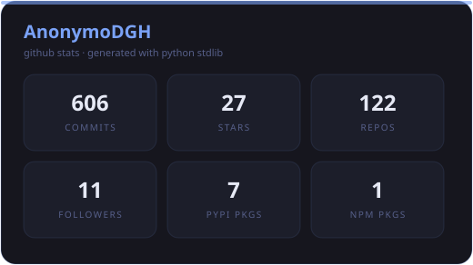
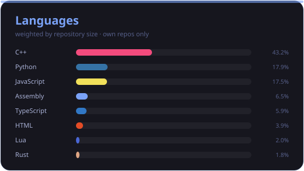
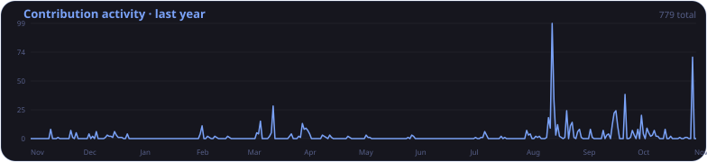
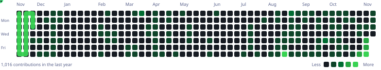

<!-- ████████████████████████████████████████████████████████████████ -->
<!--        EXPEDIENTE CLASIFICADO · ACCESO RESTRINGIDO               -->
<!--   Lo que sigue fue reconstruido a partir de tráfico interceptado -->
<!-- ████████████████████████████████████████████████████████████████ -->

<div align="center">

```
╔══════════════════════════════════════════════════════════════╗
║   CLASIFICADO · NIVEL ROJO      EXPEDIENTE #ANON-DGH           ║
║   ▓▓▓▓▓▓▓▓▓▓  SUJETO LOCALIZADO: PARCIALMENTE  ▓▓▓▓▓▓▓▓▓▓      ║
╚══════════════════════════════════════════════════════════════╝
```

# `AnonymoDGH`

**`Security tooling`** · **`Reverse engineering`** · **`Automation`**

Origen: Colombia 🇨🇴 · Estado: *activo* · Última señal: hoy

</div>

---

```c
/* whoami — reconstruido desde el núcleo */
struct operador {
    char   *alias      = "AnonymoDGH";
    char   *base        = "Colombia";
    char   *stack[]     = { "Python", "JavaScript", "C" };
    char   *metodo      = "me meto en las tripas de las cosas";
    char   *objetivos[] = { "el webpack de Discord",
                            "el protocolo de Minecraft",
                            "las APIs internas de Qwen y Baidu",
                            "un genoma en C puro" };
    char   *salida      = "codigo limpio y probado";
};
// Si tiene un endpoint, un store interno, un paquete NBT o un genoma, lo encuentro.
```

> Construyo herramientas de seguridad, clientes de ingeniería inversa y bots, y ahora
> bioinformática de bajo nivel en **C puro**. Convierto lo interno y lo no documentado
> en librerías que se instalan con un comando.

Rastros confirmados en otras redes:
[**GitHub**](https://github.com/AnonymoDGH) · [**PyPI** · 7 paquetes](https://pypi.org/user/AnonymoDGH/) · [**npm** · `mineflayer-schem`](https://www.npmjs.com/~anonymodgh)

---

<details open>
<summary><h3>▸ SECTOR 01 — ARSENAL OFENSIVO · 7 paquetes en PyPI</h3></summary>

> Python puro · solo `stdlib` · **~74k líneas** · **3.4k tests**. Cero dependencias externas.

```bash
pip install book-cipher-kit dns-tunnel-messenger metadata-stripper \
            honeypot-server hash-auditor cover-identity deadman-switch
```

| # | Paquete | Qué hace |
|---|---------|----------|
| 01 | [`book-cipher-kit`](https://github.com/AnonymoDGH/book-cipher-kit) | Cifrado de libro con Shamir secret sharing, audit trail y TUI |
| 02 | [`dns-tunnel-messenger`](https://github.com/AnonymoDGH/dns-tunnel-messenger) | Mensajería encubierta sobre DNS: shaping, fragmentación, anti-replay |
| 03 | [`metadata-stripper`](https://github.com/AnonymoDGH/metadata-stripper) | Borra metadatos (EXIF/HEIF/PDF/Office), motor de riesgo, forense de GPS |
| 04 | [`honeypot-server`](https://github.com/AnonymoDGH/honeypot-server) | Plataforma de engaño: 8 protocolos, tar pit, canary tokens, clasificador de TTPs |
| 05 | [`hash-auditor`](https://github.com/AnonymoDGH/hash-auditor) | Lab de auditoría de contraseñas: rainbow tables, PCFG, máscaras, zxcvbn-lite |
| 06 | [`cover-identity`](https://github.com/AnonymoDGH/cover-identity) | Identidades encubiertas consistentes: dossier completo, bóveda cifrada, drills |
| 07 | [`deadman-switch`](https://github.com/AnonymoDGH/deadman-switch) | Interruptor de hombre muerto: heartbeats firmados, prueba de vida, quórum, legado |

</details>

<details>
<summary><h3>▸ SECTOR 02 — INGENIERÍA INVERSA · clientes de lo no documentado</h3></summary>

| Objetivo | Operación |
|----------|-----------|
| [`Qwen-Reverse`](https://github.com/AnonymoDGH/Qwen-Reverse) | Cliente async de `chat.qwen.ai`: streaming, razonamiento, tool calling, imagen/video |
| [`baidu-reverse`](https://github.com/AnonymoDGH/baidu-reverse) | Cliente async de Baidu Wenxin: streaming, razonamiento, pool de proxies |
| [`reverse-agent`](https://github.com/AnonymoDGH/reverse-agent) | Agente de programación de terminal multi-proveedor |
| [`gguf2bin`](https://github.com/AnonymoDGH/gguf2bin) | Runtime C99: `GGUF → G2BX → inferencia` (Qwen3 / Qwen2 / Llama) |

</details>

<details>
<summary><h3>▸ SECTOR 03 — LABORATORIO DE C DE BAJO NIVEL · bio, memoria y ML auto-modificable</h3></summary>

> C puro · solo `stdlib` · **sin Python** · JIT a **x86-64** · **~15k líneas** · **113+ tests**

| Experimento | Descripción |
|-------------|-------------|
| [`seqalign`](https://github.com/AnonymoDGH/seqalign) | BLAST-lite en C11: Needleman-Wunsch + Smith-Waterman Gotoh afín, BLOSUM62, k-mer CSR — **125KB, 0 deps, 113 tests** |
| [`neuro-jit`](https://github.com/AnonymoDGH/neuro-jit) | ML auto-modificable: compila con JIT el forward pass a x86-64, pesos incrustados como inmediatos |
| [`memcore`](https://github.com/AnonymoDGH/memcore) | Micro-modelo de texto que aprende en continuo: memoria neuronal por sorpresa (Titans) + replay buffer |
| [`neuro-snake`](https://github.com/AnonymoDGH/neuro-snake) | Snake por imitación heurística, recompilado con `neuro-jit` — **speedup ×4.35** |
| [`gguf2bin`](https://github.com/AnonymoDGH/gguf2bin) | GGUF → G2BX → inferencia nativa |

</details>

<details>
<summary><h3>▸ SECTOR 04 — OPERACIONES DE CAMPO · proyectos destacados</h3></summary>

- [`mineflayer-schem`](https://github.com/AnonymoDGH/mineflayer-schem) — construye estructuras desde esquemas con mineflayer · **npm v1.5.2**
- [`Discord-Quest-Auto-Completer`](https://github.com/AnonymoDGH/Discord-Quest-Auto-Completer) — completa quests de Discord inyectándose en el webpack interno
- [`Armonia`](https://github.com/AnonymoDGH/Armonia) — genera música desde lenguaje natural · **214K partituras** → WAV/MIDI/ABC
- [`vital-agent`](https://github.com/AnonymoDGH/vital-agent) — agente autónomo que debe ganar su propio dinero… o morir
- [`OurBook`](https://github.com/AnonymoDGH/OurBook) — un MCP donde el agente no recuerda tus datos: recuerda tu historia
- [`ultimate-free-llm-resources`](https://github.com/AnonymoDGH/ultimate-free-llm-resources) — la colección más completa de recursos gratuitos de LLM
- [`rdru-lm`](https://github.com/AnonymoDGH/rdru-lm) — LM a nivel de carácter con bloque transformer iterativo + denoising
- [`nequi-clone`](https://github.com/AnonymoDGH/nequi-clone) — clon fan-made de Nequi (educativo): WebView Android + backend mock (envíos, comprobantes, saldo contable)

</details>

---

### ⌁ MANIFIESTO DE EQUIPO

```
LENGUAJES   Python · JavaScript · TypeScript · C · C11 · C++
RUNTIME     Node.js · Linux · Docker
PRUEBAS     pytest · 3.4k + 113 tests en producción
PUBLICA     PyPI · npm
RED         Wireshark · Webpack internals · internal APIs
MINECRAFT   Prismarine / mineflayer · NBT
FRONTEND    React · Next.js
```

---

<div align="center">

<!-- Los assets se regeneran a diario vía GitHub Action -->






<picture>
  <source media="(prefers-color-scheme: dark)" srcset="./assets/snake.svg" />
  <source media="(prefers-color-scheme: light)" srcset="./assets/snake-light.svg" />
  
</picture>

</div>

---

<div align="center">

### ⌁ ESTABLECER CONTACTO

*¿Tienes una idea rara, un bug interesante o quieres colaborar? Escríbeme.*

Canales abiertos: [**GitHub**](https://github.com/AnonymoDGH) · [**PyPI**](https://pypi.org/user/AnonymoDGH/) · [**npm**](https://www.npmjs.com/~anonymodgh)

```
// transmisión finalizada — la señal se corta aquí
```

</div>
