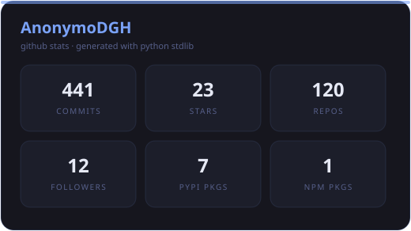
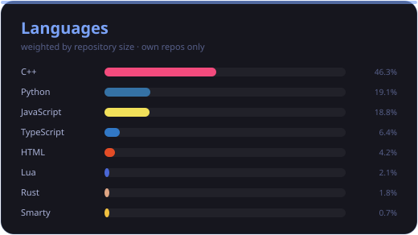
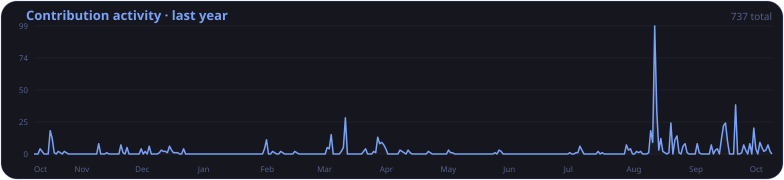
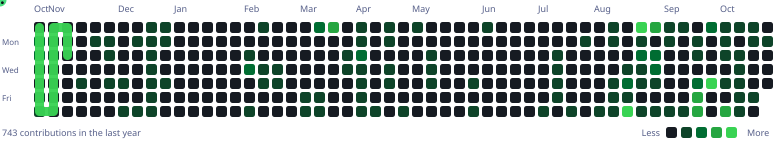

<div align="center">


**Security tooling · Reverse engineering · Automation · Colombia 🇨🇴**

[](https://github.com/AnonymoDGH)
[](https://github.com/AnonymoDGH?tab=followers)
[](https://pypi.org/user/AnonymoDGH/)
[](https://www.npmjs.com/~anonymodgh)

</div>

---

### `$ whoami`

I build security tools, reverse-engineered clients, and bots — and now low-level bioinformatics in pure C. I dig into the guts of things — Discord's webpack, the Minecraft protocol, Qwen's and Baidu's internal APIs — and turn them into clean, tested code.

Python, JavaScript and C are my stack. If it has an endpoint, an internal store, an NBT packet or a genome, I will find it.

---

### 🐍 Toolkit — 7 packages on PyPI

Pure Python (stdlib only) · ~74k lines · 3.4k tests

| Package | What it does |
| :-- | :-- |
| **[book-cipher-kit](https://github.com/AnonymoDGH/book-cipher-kit)** | Book cipher with Shamir secret sharing, audit trail, and TUI |
| **[dns-tunnel-messenger](https://github.com/AnonymoDGH/dns-tunnel-messenger)** | Covert messaging over DNS: shaping, fragmentation, anti-replay |
| **[metadata-stripper](https://github.com/AnonymoDGH/metadata-stripper)** | Strips metadata (EXIF/HEIF/PDF/Office), risk engine, GPS forensics |
| **[honeypot-server](https://github.com/AnonymoDGH/honeypot-server)** | Deception platform: 8 protocols, tar pit, canary tokens, TTP classifier |
| **[hash-auditor](https://github.com/AnonymoDGH/hash-auditor)** | Password auditing lab: rainbow tables, PCFG, masks, zxcvbn-lite |
| **[cover-identity](https://github.com/AnonymoDGH/cover-identity)** | Consistent covert identities: full dossier, encrypted vault, drills |
| **[deadman-switch](https://github.com/AnonymoDGH/deadman-switch)** | Dead man's switch: signed heartbeats, proof-of-life, quorum, legacy |

```bash
pip install book-cipher-kit dns-tunnel-messenger metadata-stripper \
            honeypot-server hash-auditor cover-identity deadman-switch
```

---

### 🔧 Reverse engineering

| Project | What it is |
| :-- | :-- |
| **[Qwen-Reverse](https://github.com/AnonymoDGH/Qwen-Reverse)** | Async client for chat.qwen.ai — streaming, reasoning, tool calling, image/video |
| **[baidu-reverse](https://github.com/AnonymoDGH/baidu-reverse)** | Async client for Baidu Wenxin — streaming, reasoning, proxy pool |
| **[reverse-agent](https://github.com/AnonymoDGH/reverse-agent)** | Multi-provider terminal coding agent |
| **[gguf2bin](https://github.com/AnonymoDGH/gguf2bin)** | C99 runtime: GGUF → G2BX → inference (Qwen3 / Qwen2 / Llama) |

---

### 🧬 Low-level C Lab — Bio, Memory & Self-modifying ML

Pure C (stdlib only, no Python) · JIT to x86-64 · ~15k lines · 113+ tests

| Project | What it does | ★ |
| :-- | :-- | :--: |
| **[seqalign](https://github.com/AnonymoDGH/seqalign)** | BLAST-lite en C11: Needleman-Wunsch + Smith-Waterman Gotoh affine, BLOSUM62, k-mer CSR — 125KB, 0 deps |  |
| **[neuro-jit](https://github.com/AnonymoDGH/neuro-jit)** | Self-modifying ML in pure C — JIT-compiles forward pass to x86-64, weights baked as immediates |  |
| **[memcore](https://github.com/AnonymoDGH/memcore)** | Micro-modelo de texto en C puro que aprende continuo — memoria neuronal por sorpresa (Titans) + replay buffer |  |
| **[neuro-snake](https://github.com/AnonymoDGH/neuro-snake)** | Snake trained by heuristic imitation, recompiled with neuro-jit — **×4.35 speedup** |  |
| **[gguf2bin](https://github.com/AnonymoDGH/gguf2bin)** | C99 runtime: GGUF → G2BX → inference (Qwen3/Qwen2/Llama) |  |

---

### 📌 Featured projects

| Project | Description | ★ |
| :-- | :-- | :--: |
| **[mineflayer-schem](https://github.com/AnonymoDGH/mineflayer-schem)** | Builds structures from schematics with mineflayer · npm v1.5.2 |  |
| **[Discord-Quest-Auto-Completer](https://github.com/AnonymoDGH/Discord-Quest-Auto-Completer)** | Completes Discord quests by injecting into the internal webpack |  |
| **[Armonia](https://github.com/AnonymoDGH/Armonia)** | Generates music from natural language · 214K scores → WAV/MIDI/ABC |  |
| **[vital-agent](https://github.com/AnonymoDGH/vital-agent)** | Autonomous agent that must earn its own money... or die |  |
| **[OurBook](https://github.com/AnonymoDGH/OurBook)** | An MCP where the agent doesn't remember your data — it remembers your story |  |
| **[ultimate-free-llm-resources](https://github.com/AnonymoDGH/ultimate-free-llm-resources)** | The most complete collection of free LLM resources |  |
| **[rdru-lm](https://github.com/AnonymoDGH/rdru-lm)** | Character-level LM with iterative transformer block + denoising |  |
| **[nequi-clone](https://github.com/AnonymoDGH/nequi-clone)** | Nequi Clone fan-made (educativo) — WebView Android + backend mock: envíos, comprobantes, saldo contable |  |

---

### 🛠️ Stack

`Python` `JavaScript` `TypeScript` `Node.js` `C` `C11` `C++`
`pytest` `PyPI` `npm` `Wireshark` `Linux` `Docker` `Git`
`React` `Next.js` `Webpack internals` `Prismarine / mineflayer`

---

### 📊 Stats

<p align="center">
  
  
</p>

### 📈 Activity

<p align="center">
  
</p>

### 🐍 Contributions

<p align="center">
  <picture>
    <source media="(prefers-color-scheme: dark)" srcset="./assets/snake.svg">
    <source media="(prefers-color-scheme: light)" srcset="./assets/snake-light.svg">
    
  </picture>
</p>

---

### 📬 Contact

[](https://github.com/AnonymoDGH)
[](https://pypi.org/user/AnonymoDGH/)
[](https://www.npmjs.com/~anonymodgh)

Got a weird idea, an interesting bug, or want to collaborate — reach out.
